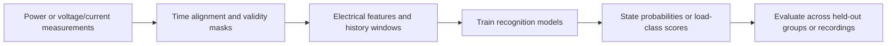

# WattSign

[English](README.md) · [简体中文](README.zh-CN.md)

**Electrical signatures for appliance recognition.**

A household electricity meter records the combined demand of many appliances. WattSign studies how that shared signal can reveal appliance activity, such as a microwave running alongside other household loads. It combines power measurements with voltage and current waveform analysis to investigate appliance-state recognition and electrical load classification.

This work belongs to **non-intrusive load monitoring (NILM)**: learning about individual appliances from measurements taken at a shared supply point. WattSign uses changes in power, waveform shape and harmonic content as electrical signatures. Its five cases cover household microwave ON/OFF recognition, controlled multi-appliance socket-state recognition, and single-appliance resistive-load classification. Their outputs are state probabilities or a load-class score; per-appliance power and energy reconstruction is outside these cases.

## Data and tasks

The three public datasets provide complementary measurement settings:

| Dataset | What it records | Use in WattSign |
|---|---|---|
| [UK-DALE](https://doi.org/10.1038/sdata.2015.7) | Electricity demand from UK homes, with whole-house measurements and individual appliance channels | Recognize microwave ON/OFF state from household aggregate signals, using 10-second or 1-second inputs. Appliance channels provide the reference labels. |
| [TDHA](https://doi.org/10.1038/s41597-024-03310-3) | High-frequency voltage/current waveforms and annotated switching events from controlled household-appliance recordings | Recognize microwave state and, in a separate task, socket supply states from aggregate waveforms: each recording has five physical sockets, mapped to 11 shared appliance-class channels across recordings. |
| [PLAID](https://doi.org/10.1038/s41597-020-0389-7) | Plug-level voltage/current recordings and metadata for individual appliances | Extract electrical features and classify a single load as resistive or non-resistive. |

UK-DALE represents household activity, TDHA provides controlled switching sequences, and PLAID supports single-load feature analysis. The tasks and evaluation splits differ, so their scores are interpreted within each case. Dataset versions, label definitions and file requirements are described in [Data](docs/en/data.md).

## What is implemented



- **Signal processing and features.** Data readers align inputs with reference labels and retain missing-data masks. Low-frequency workflows use power levels and changes; high-frequency workflows use phase-aligned voltage/current cycles, non-active current and harmonics. The PLAID case extracts 29 electrical features.
- **Models and training.** Temporal convolutional networks (TCNs) and gated recurrent units (GRUs) learn how appliance states relate to a history of measurements. Causal windows use only the present and past signal at each prediction time. A random forest classifies the PLAID feature vectors. The notebooks expose preprocessing, model definitions, losses, training and evaluation.
- **Evaluation and reusable models.** Temporal state-recognition workflows fit preprocessing on training data, choose thresholds on calibration data and keep them fixed for evaluation. PLAID uses a preset decision threshold of 0.5. Saved evidence includes every seed and fold of each selected configuration, with fitted parameters and model-loading utilities.
- **NPU training and weight conversion.** The TDHA multi-label workflow compares waveform and harmonic representations on an Ascend neural processing unit (NPU). Conversion tools produce CPU-loadable checkpoints; saved evaluations on NVIDIA GPUs using CUDA examine transfer to different recording scripts. Training hardware, evaluation hardware and checkpoint format are identified separately.

See [Methods](docs/en/methods.md) for feature construction, model configurations and evaluation protocols.

## Experiments and findings

**Average precision (AP)** summarizes how well scores rank positive states or classes. **Recall** is the fraction of positives detected at the fixed threshold. **F1** balances precision and recall; **OFF false-positive rate (FPR)** measures how often a valid OFF state is incorrectly flagged as ON. Values below summarize all recorded seeds/folds of the selected configurations.

| Task and input | Main method | Result and interpretation |
|---|---|---|
| [UK-DALE microwave state / 10 s input](docs/en/results.md#uk-dale-10-second-inputs) | Causal TCN with power features, five seeds | Household 2: AP **0.8932**, Recall **95.97%**. Recognition varies between household records. |
| [UK-DALE microwave state / 1 s input](docs/en/results.md#uk-dale-1-second-inputs-10-second-outputs) | Causal TCN, five seeds | Household 2: AP **0.9661**, Recall **94.27%**. A strong recorded result, with separate false-alarm and household comparisons below. |
| [TDHA microwave state / waveform input](docs/en/results.md#tdha-high-frequency-microwave-state) | Phase-aligned waveform GRU, two folds × three seeds | AP **0.9843**, Recall **80.23%**. Strong score ranking still leaves a substantial share of ON states undetected at the fixed threshold. |
| [PLAID resistive-load classification](docs/en/results.md#plaid-resistive-load-binary-classification) | Random forest, five location-grouped folds | AP **0.9553**, F1 **0.9281**. Electrical features distinguish the two load classes on the recorded location-grouped folds. |
| [TDHA multi-socket state / NPU training](docs/en/results.md#tdha-npu-trained-multi-label-models) | Waveform GRU versus harmonic convolutional model, 12 runs | CUDA cross-script AP **0.7519** versus **0.7364**. The harmonic candidate's advantage within a recording script did not carry over to different scripts. |

**Input resolution**, **prediction step** and **history length** describe different parts of a model. The 1-second UK-DALE case issues predictions every **10 seconds**. The TDHA waveform case reads **51.2 kHz** measurements and uses **51.2 seconds** of past context. The two UK-DALE configurations also differ in protocol, so their score difference does not isolate the effect of sampling resolution.

### UK-DALE: recognition and false alarms vary by household record

The 1-second-input TCN reaches **AP 0.9661, Recall 94.27% and high-power OFF FPR 0.656%** on household 2. The last metric counts false alarms while the microwave is OFF and household demand is at least 800 W. It tests whether other substantial loads are confused with the target appliance.

The figure compares household 1's earlier and later partitions with household 2, labelled H1 and H2. Performance changes across these records. Both households were exposed during development; these are exploratory comparisons, and unseen-household deployment remains untested.


[Protocol, uncertainty and baseline comparison](docs/en/results.md#uk-dale-1-second-inputs-10-second-outputs)

### TDHA: better within-script scores did not transfer across scripts

Two NPU-trained models use different signal representations: **N0-W1** is the waveform GRU reference; **N1-F** is the harmonic convolutional candidate. A recording script specifies appliance switching sequences. Temporal hold-out tests use a later portion of a script, while cross-script tests use a different switching sequence.

Primary AP and recall cover six appliance classes supported by both recording scripts. N1-F performs better on the NPU temporal hold-out but loses AP and recall in CUDA cross-script evaluation. Its cross-script AP difference against N0-W1 is **−0.015522**, with a 95% paired-block confidence interval of **[−0.027810, −0.003263]**. The candidate did not meet the fixed selection criteria. The result shows why a favorable within-script score is insufficient evidence of transfer to other operating sequences.

Points represent all six fold/seed runs per method. NPU training and temporal evaluation, CUDA cross-script evaluation, and CPU checkpoint conversion have separate scopes; complete NPU workflow validation is still partial.


[Per-run figure data (JSON)](results/tdha-npu/figure_data.json) · [Full comparison and evaluation scope](docs/en/results.md#tdha-npu-trained-multi-label-models)

## Getting started

```sh
python -m pip install -e .
python -m wattsign results list
python -m wattsign results show tdha-npu
```

These commands read existing results. The three notebooks contain the implementation and complete training workflows:

| Notebook | Starting point |
|---|---|
| [Low-frequency recognition](notebooks/01_low_frequency.ipynb) | Household aggregate power, microwave labels and causal TCN training |
| [High-frequency and NPU recognition](notebooks/02_high_frequency.ipynb) | TDHA waveforms, physical features, GRU and multi-label workflows |
| [PLAID classification](notebooks/03_plaid.ipynb) | Single-load features, grouped cross-validation and random-forest training |

For a new run, configure local raw data and a fresh output directory, then enable the relevant execution switches. [Quick start](docs/en/quickstart.md) covers installation and configuration; [Runtime](docs/en/runtime.md) covers CPU, CUDA and NPU environments.

## Repository

`src/` contains data readers, signal processing, models and checkpoint compatibility; `research/` contains training workflows. `results/` holds metrics, figures and experiment records. The NPU workflow and conversion tools are in `npu/tdha_multilabel_v3/`. Detailed guides are available in [English](docs/en/README.md) and [Chinese](docs/zh-cn/README.md).

## Models and predictions

Model weights, fitted normalizers, thresholds and prediction files are listed in the [artifact manifest](results/release-assets.json). To request files, email **ruizhang.eric@gmail.com** with the experiment, required artifacts and intended use. Obtain raw measurements from the dataset publishers linked in [Data](docs/en/data.md).

## License and citation

Code and documentation use the [MIT license](LICENSE). Model weights and dataset-derived results use CC BY 4.0; third-party components retain their licenses. See [Third-party notices](THIRD_PARTY_NOTICES.md) for details.

Use [CITATION.cff](CITATION.cff) to cite WattSign, and include the software version or commit and the datasets used in the experiment. Dataset and method references are collected in [References](docs/en/references.md).
