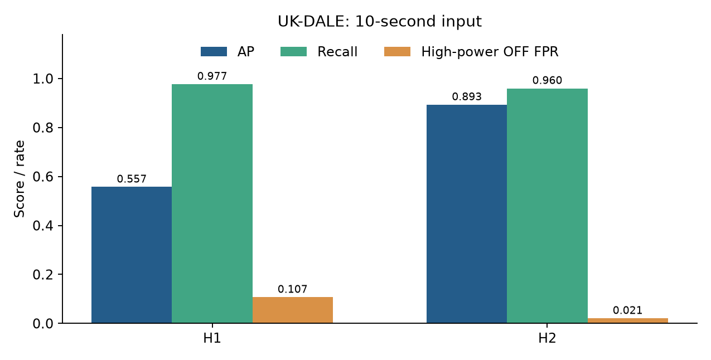
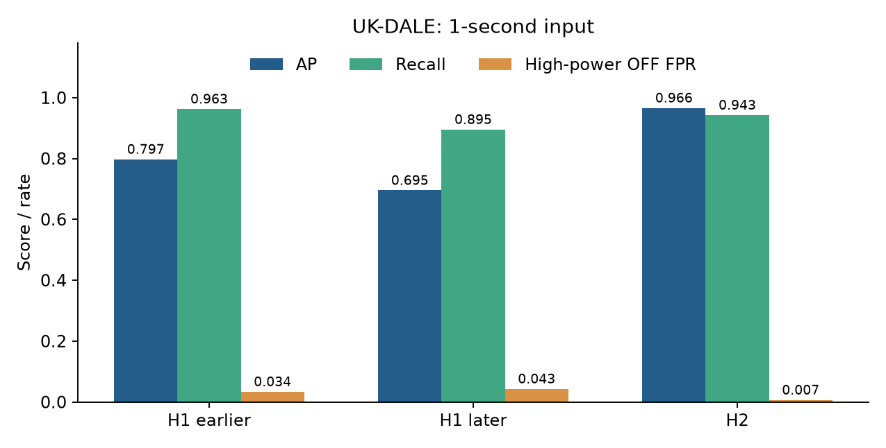
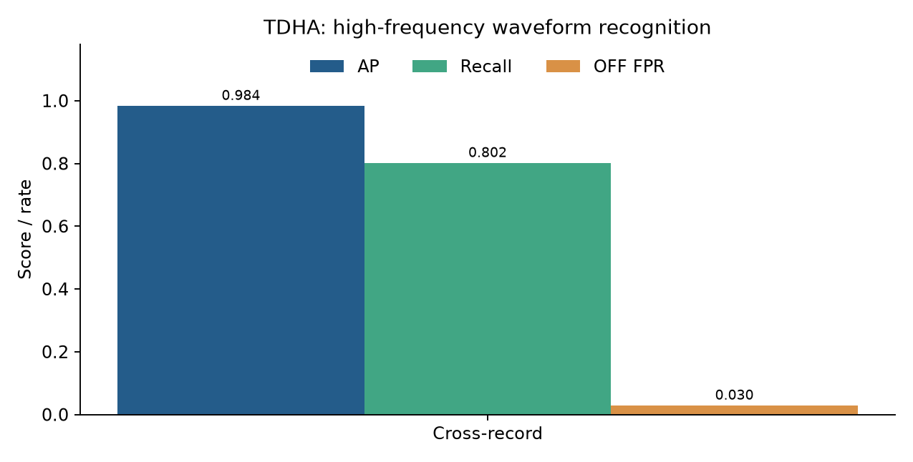
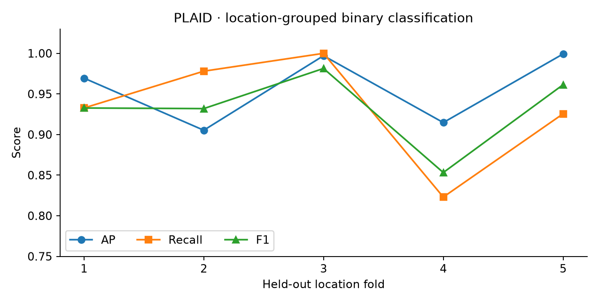
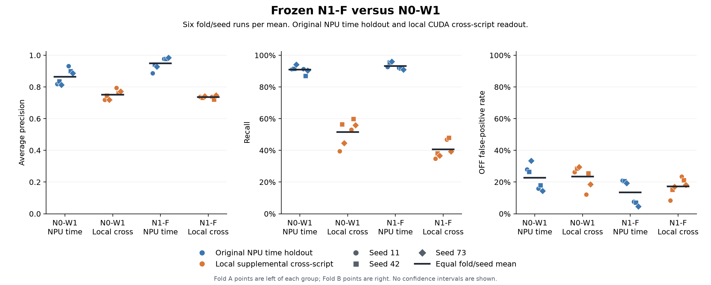

# 实验结果

[English](../en/results.md) · [文档导航](README.md)

五个案例分别研究家庭总表中的微波炉状态、受控波形中的微波炉与多个插座状态，以及单设备记录的电阻性负载分类。数据背景与标签定义见[数据说明](data.md)，模型输入、指标和汇总方式见[方法](methods.md)。

各案例汇总主方案全部已记录 seed 和 fold。精确数值、运行标识及文件校验值见对应的 `summary.json` 和 `source.json`。较高平均精确率（AP）表示较好的排序能力；召回率衡量固定阈值下识别出的正类比例；误报率（FPR）衡量负类被误判为正类的比例。各任务的标签与指标分母不同，对照在案例内部进行。

## UK-DALE：10 秒输入

[V6 TCN / PQ 摘要](../../results/ukdale-10s/summary.json) · [来源](../../results/ukdale-10s/source.json)

这个案例研究其他设备共同参与总负载时，一段家庭总表测量能否识别微波炉 ON/OFF 状态。因果时序卷积网络（TCN）使用有功功率及派生非有功功率幅值，历史长度为 640 秒。指标对五个 seed 等权平均，H1、H2 分别表示 House 1、House 2。

| 划分 | AP | Recall | 高功率 OFF FPR |
|---|---:|---:|---:|
| H1 | 0.5573 | 97.69% | 10.705% |
| 已暴露的 H2 | 0.8932 | 95.97% | 2.077% |

模型在两个划分中均识别出大部分已标注 ON 状态，但排序能力与误报在家庭之间存在明显差异。H1 的高召回同时伴随较多对其他负载的混淆。高功率 OFF FPR 统计微波炉关闭、家庭总表功率至少 800 W 时的误报。

H2 在探索阶段已被使用，不属于独立家庭盲测。可用成果包括指标和拟合组件；该配置未保存独立逐点预测。

[不确定性记录](../../results/ukdale-10s/confidence.json)：H1 的 PQ−P-only 配对**日 AP 效应**记录了 95% 区间下端点 0.498969，上端点未保存。该区间针对逐日方法差值，而非绝对 AP 或整段 AP 差值。H2 没有可用区间。

## UK-DALE：1 秒输入、10 秒输出

[V11 cold2 TCN 摘要](../../results/ukdale-1s/summary.json) · [来源](../../results/ukdale-1s/source.json)

这个案例在 640 秒历史中保留原生 1 秒家庭测量，同时每 10 秒评测一次预测。目标仍为微波炉 ON/OFF 状态。五个 seed 在 H2 自然分布端点上的结果为：

| 方法 | AP | Recall | 高功率 OFF FPR |
|---|---:|---:|---:|
| M0_TCN-F0 参考 | 0.9661 | 94.27% | 0.656% |
| 直方图梯度提升（HGB） | 0.9720 | 75.04% | 0.299% |

TCN 在该划分上兼顾较高召回与较少误报。HGB 的 AP 略高、误报更少，但在其固定阈值下识别出的 ON 状态明显减少，未满足替换 TCN 参考模型的综合条件。这说明识别模型的选择需要同时考虑排序能力和阈值相关指标。

[配对效应区间](../../results/ukdale-1s/confidence.json)：HGB−TCN 的 Recall 95% CI 为 **[−0.266112, −0.122001]**；AP 区间为 **[−0.017574, 0.021525]**，跨零。这些区间描述 H2 上的方法差值。

图中还展示较早和较晚的 H1 划分，分数随划分而变化。H2 在开发中已被使用，未见 H5/REFIT 部署不在本次评测范围内。10 秒与 1 秒案例采用不同协议，比较不能单独证明更细输入分辨率带来的收益。

## TDHA：高频微波炉状态

[V2 GRU/W1/L2560 摘要](../../results/tdha-waveform/summary.json) · [来源](../../results/tdha-waveform/source.json)

这个案例使用 51.2 kHz 总表电压、电流波形，在受控设备组合中识别微波炉状态。相位对齐波形特征与门控循环单元（GRU）使用 **51.2 秒过去上下文**。波形采样率和上下文长度是不同的量。

汇总两个跨记录族方向及 seed 11/42/73 后得到 **AP 0.9843，Recall 80.23%，OFF FPR 2.96%**。模型对 ON/OFF 状态的排序表现较好，整体误报较少，但在固定阈值下仍漏掉约五分之一的已标注 ON 状态。因此，较好的排序能力并不意味着同样高的检测召回。

[配对效应区间](../../results/tdha-waveform/confidence.json)比较 GRU/W1/L2560−TCN/P/L640，AP 95% CI 为 **[0.101870, 0.142079]**。该对照同时改变架构、表示和历史长度，因此差值不能单独归因于某一个因素。证据范围为受控、前期已使用过的记录，未覆盖未见家庭部署。

## PLAID：电阻性负载二分类

[随机森林摘要](../../results/plaid-resistive/summary.json) · [来源](../../results/plaid-resistive/source.json)

这个案例研究单设备记录的电气特征能否识别本项目的电阻性／非电阻性标签。随机森林使用 29 项功率、相位、波形形状和谐波特征。五折采集地点分组覆盖 1,793 条记录、55 个地点：**AP 0.9553，Recall 92.52%，F1 0.9281**。

结果支持这个二分类电气属性模型在留出地点分组上的表现，未评测完整设备类型识别或加热元件活动检测。采集地点分组限制了训练与评测之间采集条件的重叠。

所报告指标来自留出的**折外预测（OOF）**：每条记录都由未使用其地点分组训练的模型预测。模型包另含在全部样本上拟合的最终 pipeline，其训练集预测与 OOF 评测分别使用。

[不确定性记录](../../results/plaid-resistive/confidence.json)：本案例未记录置信区间。五折数值反映折间变化，这种变化本身不是置信区间。

## TDHA：NPU 训练的多标签模型

[对照摘要](../../results/tdha-npu/summary.json) · [来源](../../results/tdha-npu/source.json)

这个案例从叠加的电压、电流信号预测多个插座供电状态。插座 ON 表示供电，可能包含设备内部加热元件停止工作的时段。N0-W1 是波形／GRU 参考模型，N1-F 是频域特征／卷积候选模型。

12 个运行覆盖两种方法、两折及 seed 11/42/73。训练和时间留出预测使用神经网络处理器（NPU）。跨脚本、第三记录评测使用固定权重与阈值，通过 CUDA 在 NVIDIA GPU 上完成。CPU 格式权重用于可移植模型加载。现有 NPU 记录覆盖训练和时间留出评测，未覆盖整个评测流程或跨硬件数值等价验证。

| 同脚本时间留出（NPU） | AP | Recall | OFF FPR |
|---|---:|---:|---:|
| N0-W1 参考 | 0.8647 | 90.87% | 22.699% |
| N1-F 候选 | 0.9492 | 93.14% | 13.391% |

| 跨脚本方法（CUDA） | AP | Recall | OFF FPR |
|---|---:|---:|---:|
| N0-W1 参考 | 0.751895 | 51.5506% | 23.4240% |
| N1-F 候选 | 0.736373 | 40.6307% | 17.2494% |

N1-F 在同一已记录脚本内改善了排序、召回和误报，但优势未延续到另一脚本。跨脚本测试中，它以 AP 和召回下降为代价减少误报。这说明模型在所测采集条件间的迁移能力有限；评测范围的变化也使分数下降无法单独归因于硬件。

| 跨脚本候选减参考 | 差值 | 95% 配对区块置信区间 |
|---|---:|---:|
| AP | −0.015522 | [−0.027810, −0.003263] |
| Recall | −0.109199 | [−0.121639, −0.096492] |
| OFF FPR | −0.061746 | [−0.068998, −0.054570] |

配对比较保留相同的折、seed 和记录结构。AP 与召回区间均低于零，FPR 下降则表示误报减少。N1-F **未满足冻结的选择判据**，该判据在平均误报之外还包含性能保护要求。部分缺席类别仍有较高误报率。第三记录中类别支持不足的总体 AP/Recall 记为 `null`。

## 模型与预测

[成果清单](../../results/release-assets.json)列出模型、预测和完整证据包的大小及 SHA-256 校验值。文件内容与获取方式见[运行环境与成果](runtime.md)。